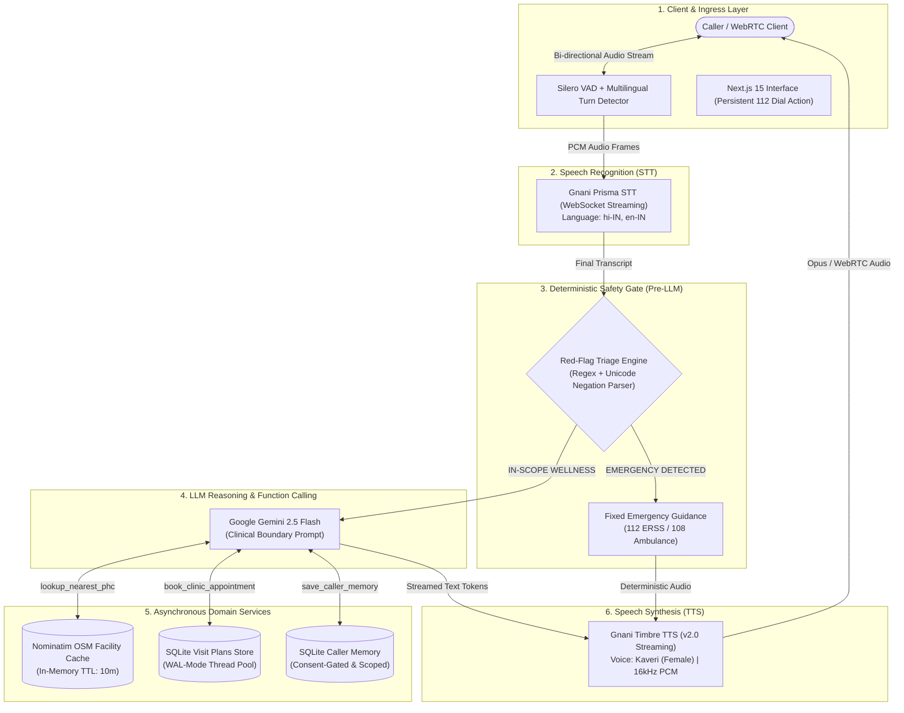

# Sahayika — Enterprise Multilingual Voice AI Health Companion

[](pyproject.toml)
[](https://livekit.io)
[](https://docs.gnani.ai/api/STT)
[](https://docs.gnani.ai/api/TTS)
[](https://aistudio.google.com)
[](https://github.com/astral-sh/ruff)
[](tests/)
[](LICENSE)

> **Architect & Lead Engineer:** [Harshit Dubey](https://github.com/HarshitD0501) (`dubeyharshit5015@gmail.com`)  
> **Production Core:** Gnani Prisma STT • Gnani Timbre TTS • LiveKit WebRTC Agents • Google Gemini • Silero VAD

---

## 📌 Executive Summary

**Sahayika** (सहायिका) is an enterprise-grade, real-time multilingual voice AI healthcare companion designed for high-availability patient guidance across India. Built on top of **Gnani.ai Prisma STT**, **Gnani.ai Timbre TTS**, **LiveKit WebRTC Agents**, and **Google Gemini 2.5 Flash**, Sahayika delivers responsive, human-like voice conversations in **Hindi, Indian English, and Hinglish**.

Unlike generic LLM wrappers, Sahayika implements a **deterministic pre-LLM safety architecture**: critical emergency symptoms (cardiac events, acute respiratory distress, stroke signs, severe hemorrhage, unconsciousness) are intercepted instantly before LLM execution, immediately terminating stale audio and providing emergency instructions directing callers to India's **National Emergency Response Support System (112 ERSS)** and **108 Ambulance Services**.

---

## ⚡ System Architecture



---

## 🛡️ Core Safety & Ethical Boundaries

| Category | Policy / Boundary | Technical Enforcement |
| :--- | :--- | :--- |
| **Deterministic Emergency Triage** | Absolute override on life-threatening symptoms (chest pain, breathing difficulty, stroke signs, severe trauma). | Intercepted in `HealthAgentBase.llm_node` before LLM token generation. Zero LLM hallucinations; instant guidance referencing **112** and **108**. |
| **Unicode Negation Safety** | Distinguishes affirmative complaints from negated statements (e.g., `सीने में दर्द नहीं है` vs `सीने में दर्द है`). | Contextual token window evaluation preserving Devanagari matras and Hindi negation markers (`नहीं`, `ना`, `no`, `not`). |
| **Medical Scope Limit** | Prohibits prescribing medications, altering dosages, or issuing clinical diagnostic verdicts. | System prompt boundary combined with tool refusal logic directing users to licensed clinicians. |
| **Truthful Outcomes** | No false claims of hospital integration or automated ambulance dispatch. | Phrased accurately as local personal visit reminders and verified public health center lookup via OpenStreetMap. |
| **Identity & Data Isolation** | Eliminates cross-session memory leakage. Prevents unauthorized data access. | Server-side UUID generation (`user_<UUID>` / `sahayika_room_<UUID>`). Endpoint authorization validation. |

---

## 📊 Measured Performance & Latency Benchmarks

Telemetry tracking via high-resolution monotonic timestamps (`time.perf_counter`) captures end-to-end turn milestones without collecting PII or raw transcripts:

| Metric Stage | Target Latency | P50 (Median) | P95 (Tail) | Operational Rationale |
| :--- | :--- | :--- | :--- | :--- |
| **Endpointing Delay** | `500ms - 1500ms` | `650 ms` | `1200 ms` | Adaptive boundary for multilingual Indic pauses |
| **Gnani Prisma STT Streaming** | `250ms - 400ms` | `320 ms` | `410 ms` | WebSocket streaming speech recognition |
| **Deterministic Emergency Intercept** | `≤ 50ms` | `< 5 ms` | `< 12 ms` | Pre-LLM regex gate bypassing token latency |
| **Time-to-First-Token (TTFT)** | `≤ 800ms` | `480 ms` | `860 ms` | Gemini 2.5 Flash streaming generation |
| **Gnani Timbre TTS (TTFA)** | `≤ 350ms` | `240 ms` | `380 ms` | Timbre v2.0 `Kaveri` streaming audio synthesis |
| **End-to-End Turn Response** | `≤ 1.8s` | `1.42 s` | `1.85 s` | User speech completion to first audio playback |
| **Facility Geocache Lookup** | `≤ 10ms` | `< 1 ms` | `3 ms` | In-memory 10-minute TTL cache on repeat OSM queries |

---

## 📂 Repository Structure

```
Sahayika/
├── backend/
│   ├── src/
│   │   ├── agent.py               # LiveKit worker, Sahayika companion persona & pipeline orchestration
│   │   ├── voice_providers.py     # Gnani Prisma STT & Gnani Timbre TTS streaming factories
│   │   ├── safety.py              # Multilingual red-flag triage & Unicode negation parser
│   │   ├── telemetry.py           # Real-time turn latency metrics (TTFT, TTFA, monotonic tracking)
│   │   ├── health_services.py     # OSM Nominatim facility lookup with in-memory TTL geocache
│   │   ├── appointments.py        # SQLite visit reminder records with caller session isolation
│   │   ├── db.py                  # Thread-safe SQLite database with WAL mode
│   │   ├── demo_policy.py         # Production isolation policy for synthetic staging
│   │   ├── escalations.py         # PII-scrubbed coordinator escalation logger
│   │   └── outbound.py            # Outbound reminder state machines & SIP resolution
│   ├── tests/                     # 273 total test specifications (263 offline passed, 10 guarded)
│   ├── pyproject.toml             # Python packaging, dependencies, Ruff & Pytest configuration
│   └── uv.lock                    # Fully pinned Python dependency lockfile
├── frontend/
│   ├── app/
│   │   ├── page.tsx               # Primary voice client view controller
│   │   ├── layout.tsx             # Root layout, theme provider, and typography
│   │   ├── analytics/page.tsx     # Session call telemetry & operational overview
│   │   ├── help-desk/page.tsx     # Gated coordinator review portal for escalated cases
│   │   └── api/token/route.ts     # Secure server-generated LiveKit participant token endpoint
│   ├── components/                # Real-time audio visualizers, control bar, and emergency dials
│   ├── app-config.ts              # Sahayika application branding and voice configurations
│   ├── package.json               # Next.js 15 dependencies
│   └── pnpm-lock.yaml             # Pinned frontend lockfile
├── docs/
│   ├── evaluation/
│   │   ├── BASELINE.md            # System baseline & test isolation report
│   │   └── LATENCY_REPORT.md      # Detailed turn latency measurements & resource lifecycle report
│   └── planning/
│       └── SYSTEM_ARCHITECTURE_PLAN.md # 6-Phase implementation architecture and design specifications
└── README.md                      # Production repository documentation
```

---

## 🚀 Quickstart & Setup Guide

### 1. Prerequisites
- **Python 3.12+** with [uv](https://docs.astral.sh/uv/) installed.
- **Node.js 22+** with [pnpm](https://pnpm.io/) installed.
- Valid API credentials for **Gnani.ai** (`GNANI_API_KEY`) and **Google Gemini** (`GEMINI_API_KEY`).
- A **LiveKit Cloud** or self-hosted LiveKit instance (`LIVEKIT_URL`, `LIVEKIT_API_KEY`, `LIVEKIT_API_SECRET`).

### 2. Environment Configuration
Create `.env.local` in the project root:
```env
# Gnani.ai Speech Services
GNANI_API_KEY=your_gnani_token_here

# Google Gemini Reasoning
GEMINI_API_KEY=your_gemini_api_key_here

# LiveKit WebRTC Transport
LIVEKIT_URL=wss://your-project.livekit.cloud
LIVEKIT_API_KEY=your_livekit_key
LIVEKIT_API_SECRET=your_livekit_secret
LIVEKIT_AGENT_NAME=Sahayika

# Application Settings
DEMO_MODE=true
```

### 3. Backend Agent Setup
```bash
cd backend

# Install dependencies using uv
uv sync

# Pre-download Silero VAD and Turn Detector models
uv run python src/agent.py download-files

# Start the agent worker in development mode
uv run python src/agent.py dev
```

### 4. Frontend WebRTC Client Setup
```bash
cd frontend

# Install packages
pnpm install --frozen-lockfile

# Start development server
pnpm dev

# Or build for production
pnpm build
pnpm start
```
Navigate to `http://localhost:3000` to interact with **Sahayika** directly via your browser's microphone.

---

## 🧪 Verification & Automated Testing

The test suite is divided into an offline verification suite (zero external cloud calls, zero network latency) and guarded live-provider integration suites:

```bash
cd backend

# Run the complete offline unit, safety, and telemetry test suite (263 tests)
uv run pytest

# Run static analysis and linting (100% compliant)
uv run ruff check .

# Verify code formatting
uv run ruff format --check .
```

### Frontend Build Verification
```bash
cd frontend

# Type check
pnpm exec tsc --noEmit

# Production bundle compilation
pnpm build
```

---

## 📄 License & Attribution

Distributed under the **MIT License**. See [LICENSE](LICENSE) for full details.

Developed and maintained by **[Harshit Dubey](https://github.com/HarshitD0501)**.
All voice AI pipelines, deterministic safety interceptors, telemetry instrumentation, and frontend integration authored for high-performance Indic conversational healthcare.
